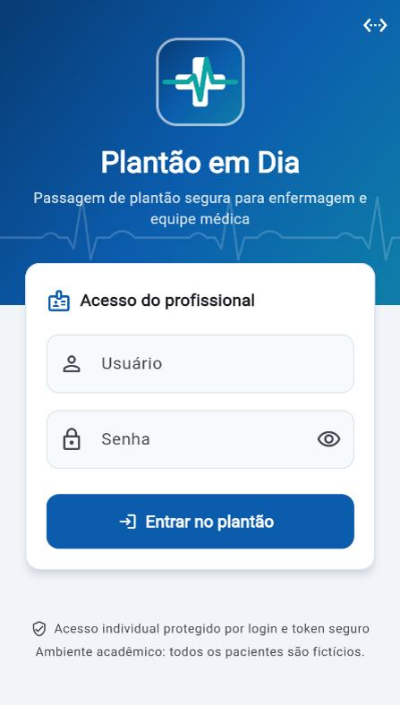
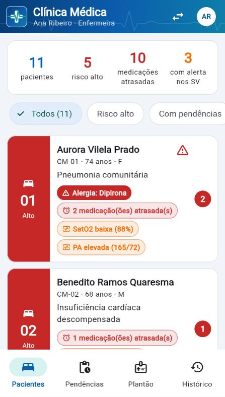
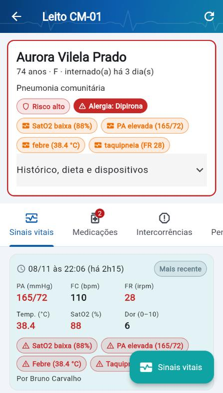
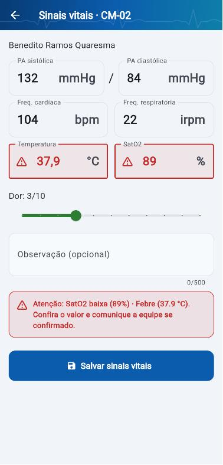
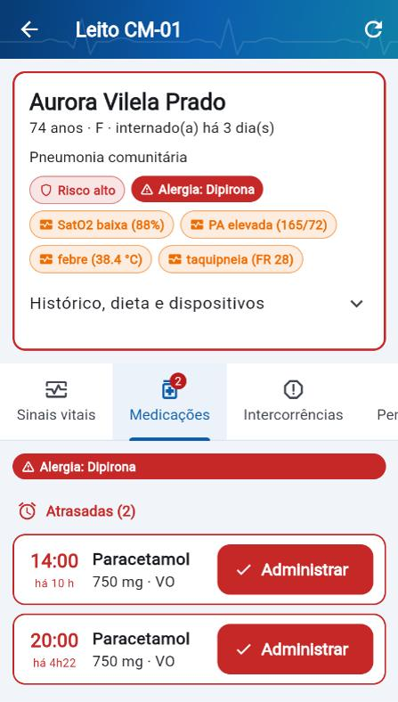
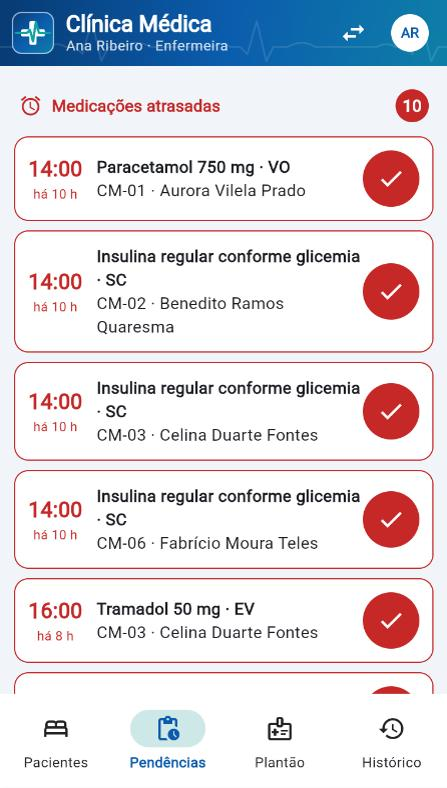
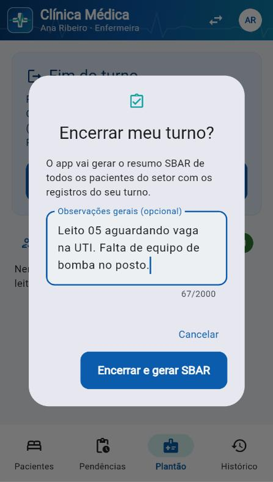
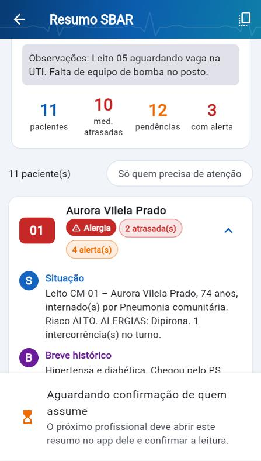
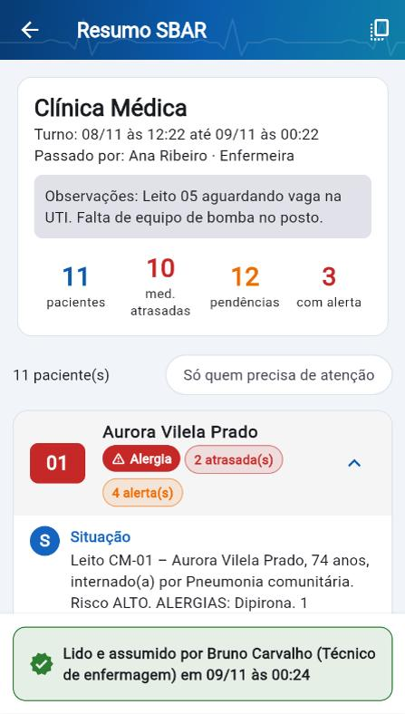

<p align="center"></p>

# Plantão em Dia

Aplicativo mobile em **Flutter** que apoia a **passagem de plantão** entre turnos de enfermagem e equipe médica. O profissional registra sinais vitais, intercorrências e medicações durante o turno; ao final, o app gera um **resumo padronizado no formato SBAR** (Situação, Breve histórico, Avaliação, Recomendação) que quem assume o próximo turno lê e confirma.

Projeto Semestral da disciplina **Programação para Dispositivos Móveis** – USCS (Prof. Me. Raphael Lopes de Souza).

> **Aviso:** todos os pacientes, profissionais e registros deste repositório são **fictícios** e gerados automaticamente pelo script de seed. Nenhum dado real de paciente é usado ou armazenado.

---

## Sumário

- [O problema](#o-problema)
- [A solução](#a-solução)
- [Pesquisa de campo](#pesquisa-de-campo)
- [Funcionalidades](#funcionalidades)
- [Telas](#telas)
- [Arquitetura](#arquitetura)
- [API REST](#api-rest)
- [Como rodar](#como-rodar)
- [Usuários de teste](#usuários-de-teste)
- [Testes](#testes)
- [Tecnologias](#tecnologias)
- [Integrantes](#integrantes)

## O problema

Na maioria dos setores a troca de turno é feita de forma verbal ou em papel. Informações se perdem (medicações pendentes, sinais vitais alterados, intercorrências, exames por colher) e isso gera atraso no cuidado e risco ao paciente.

## A solução

O **Plantão em Dia** organiza o turno em um só lugar:

1. lista os pacientes do setor por leito, com cor de risco, alergias e quantidade de pendências;
2. registra sinais vitais e intercorrências em poucos toques, com alerta visual para valores fora da faixa (ex.: SatO2 < 92%);
3. mostra o checklist de medicações por horário e destaca as atrasadas (com notificação local no Android/iOS);
4. reúne as pendências do setor (medicações atrasadas, exames, procedimentos e pareceres);
5. ao tocar em **"Encerrar meu turno"**, gera o **SBAR de cada paciente** a partir dos registros do turno;
6. quem assume abre o resumo e toca em **"Li e assumo o plantão"**, registrando nome e horário;
7. guarda o histórico de plantões do setor.

> Como o app ajuda cada profissional (enfermagem, médicos, residentes, gestão), o que já existe sobre o tema (SBAR, I-PASS, OMS, Tasy, MV, Epic…) e o que diferencia a nossa proposta: [`docs/IDEIA_E_REFERENCIAS.md`](docs/IDEIA_E_REFERENCIAS.md).

## Pesquisa de campo

Pesquisa aplicada exclusivamente a profissionais da saúde que trabalham com troca de turno, de 01/11 a 08/11/2026, via Google Forms.

- Planilha com respostas, tabulação e gráficos: [`docs/pesquisa/Pesquisa_Plantao_em_Dia.xlsx`](docs/pesquisa/Pesquisa_Plantao_em_Dia.xlsx)
- Resumo com tabelas e falas dos profissionais: [`docs/pesquisa/RESUMO_PESQUISA.md`](docs/pesquisa/RESUMO_PESQUISA.md)

| Indicador | Resultado |
|---|---:|
| Total de respondentes | **23** (8 técnicos/auxiliares de enfermagem, 7 enfermeiros, 4 médicos, 3 residentes, 1 fisioterapeuta) |
| Passam o plantão verbalmente ou em papel | **96%** |
| Não têm roteiro padronizado (SBAR) seguido no setor | **83%** |
| Percebem perda de informação com frequência (nota 4 ou 5) | **52%** |
| Já presenciaram erro ou atraso por falha na passagem | **83%** |
| Discordam que a forma atual seja segura e eficiente | **57%** |
| Usariam o app (nota 4 ou 5) | **74%** |
| Funções mais pedidas | checklist de medicações com aviso de atraso (57%), pendências (48%), registro rápido de sinais vitais e intercorrências (35%), lista de pacientes com alertas, resumo padronizado e confirmação de leitura (30% cada) |
| Maior preocupação | segurança e sigilo dos dados – LGPD (48%) → login com JWT, token em armazenamento seguro e dados 100% fictícios |

> "Tudo que estiver pendente tem que estar anotado. A gente passa 20 leitos em meia hora, impossível lembrar de tudo de cabeça." – enfermeiro(a), UTI

## Funcionalidades

| Função (pedida na pesquisa) | Onde está no app | Endpoint |
|---|---|---|
| Login e escolha do setor | Login → Escolha o setor | `POST /auth/login`, `GET /setores` |
| Lista de pacientes com leito e alertas | Pacientes | `GET /setores/:id/pacientes` |
| Detalhe do paciente | Pacientes → card do leito | `GET /pacientes/:id` |
| Registro rápido de sinais vitais | Detalhe → aba Sinais vitais → botão | `POST /pacientes/:id/sinais-vitais` |
| Registro de intercorrências | Detalhe → aba Intercorrências → botão | `POST /pacientes/:id/intercorrencias` |
| Checklist de medicações com aviso de atraso | Detalhe → aba Medicações + notificação local | `PATCH /medicacoes/:id` |
| Pendências (exames, procedimentos, retornos) | Pendências | `GET /pendencias?setor=`, `PATCH /pendencias/:id` |
| Resumo automático no formato SBAR | Plantão → Encerrar meu turno | `POST /plantoes`, `GET /plantoes/:id` |
| Confirmação de leitura por quem assume | Resumo SBAR → Li e assumo o plantão | `POST /plantoes/:id/confirmar` |
| Histórico dos plantões | Histórico | `GET /plantoes?setor=` |

Todas as telas que usam a API têm estado de **carregando**, **erro com "Tentar novamente"** e **vazio**. A interface é toda em português, com botões grandes e poucos toques por registro.

## Telas

O protótipo de baixa fidelidade está em [`docs/prototipo/prototipo_baixa_fidelidade.html`](docs/prototipo/prototipo_baixa_fidelidade.html) (abra no navegador).

| # | Tela | Consome a API |
|---|---|:---:|
| 1 | Login + escolha do setor | ✅ |
| 2 | Pacientes do setor | ✅ |
| 3 | Detalhe do paciente (abas Sinais vitais / Medicações / Intercorrências / Pendências) | ✅ |
| 4 | Registrar sinais vitais / intercorrência | ✅ |
| 5 | Checklist de medicações | ✅ |
| 6 | Pendências do setor | ✅ |
| 7 | Passagem de plantão + resumo SBAR + confirmação | ✅ |
| 8 | Histórico de plantões | ✅ |

Prints do app rodando contra a API (versão web em tamanho de celular; se quiser, troque pelos prints do emulador em [`docs/prints/`](docs/prints/)):

| Login | Pacientes | Detalhe | Sinais vitais (alerta) | Medicações |
|---|---|---|---|---|
|  |  |  |  |  |

| Pendências | Encerrar turno | Resumo SBAR | Plantão assumido |
|---|---|---|---|
|  |  |  |  |

## Arquitetura

```
/
├── backend/                 API REST em Node.js + Express (persistência em arquivo JSON)
│   ├── src/
│   │   ├── server.js        sobe a API (gera os dados fictícios se o banco não existir)
│   │   ├── app.js           Express, CORS, tratamento de erros em JSON
│   │   ├── rotas.js         todos os endpoints
│   │   ├── sbar.js          geração do resumo SBAR
│   │   ├── regras.js        medicação atrasada, alertas de sinais vitais
│   │   ├── validacao.js     validação de entrada
│   │   ├── auth.js          JWT
│   │   ├── db.js            leitura/gravação do arquivo JSON
│   │   └── seed.js          dados fictícios (npm run seed)
│   └── test/                testes dos endpoints e do SBAR (node:test)
├── mobile/                  App Flutter
│   └── lib/
│       ├── models/          classes de domínio + parsing do JSON
│       ├── services/        dio (interceptor de token e erros), endpoints, armazenamento seguro, notificações
│       ├── providers/       estado com Riverpod (sessão, setor, dados da API)
│       ├── screens/         telas
│       ├── widgets/         componentes (estados de carregando/erro/vazio, etiquetas de risco)
│       └── utils/           formatação de datas pt-BR
├── docs/
│   ├── pesquisa/            planilha da pesquisa de campo + resumo
│   ├── prototipo/           protótipo de baixa fidelidade
│   └── prints/              prints das telas
└── README.md
```

**Fluxo:** o app autentica em `POST /auth/login` e guarda o JWT no `flutter_secure_storage`. O interceptor do `dio` envia `Authorization: Bearer <token>` em toda requisição e, se a API responder 401, encerra a sessão e volta para o login. Os dados de cada tela vêm de `FutureProvider`s do Riverpod, que são invalidados depois de cada registro para a lista e os contadores se atualizarem.

**Medicação atrasada:** dose com status `pendente` cujo horário passou há mais de 30 minutos (tolerância configurável em `TOLERANCIA_ATRASO_MIN`).

**Geração do SBAR (`backend/src/sbar.js`):** para cada paciente do setor, considera só os registros entre o início do turno (fim do último plantão do setor, no máximo 12 h atrás) e o momento do encerramento:

- **S – Situação:** leito, nome, idade, diagnóstico, risco, alergias e quantas intercorrências houve no turno;
- **B – Breve histórico:** histórico clínico, dias de internação, dispositivos e dieta;
- **A – Avaliação:** últimos sinais vitais do turno com alertas, intercorrências e quantas medicações foram administradas;
- **R – Recomendação:** medicações atrasadas, próximas doses (6 h), pendências abertas e condutas (ex.: reavaliar sinais vitais).

## API REST

Base: `http://localhost:3000` (no emulador Android: `http://10.0.2.2:3000`). Todas as rotas, exceto login e `/health`, exigem `Authorization: Bearer <token>`. Erros sempre voltam em JSON: `{ "erro": "...", "detalhes": ["..."] }`.

| Método | Rota | Descrição |
|---|---|---|
| `GET` | `/health` | Verifica se a API está no ar |
| `POST` | `/auth/login` | `{usuario, senha}` → `{token, usuario}` (JWT com nome, cargo e setor) |
| `GET` | `/setores` | Setores com total de pacientes, risco alto e medicações atrasadas |
| `GET` | `/setores/:id/pacientes` | Pacientes do setor com leito, risco, alergias, alertas e nº de pendências |
| `GET` | `/pacientes/:id` | Detalhe, últimos sinais vitais, prescrições do dia, intercorrências e pendências |
| `POST` | `/pacientes/:id/sinais-vitais` | `{pas, pad, fc, fr, temperatura, satO2, dor, observacao}` (faixas validadas) |
| `POST` | `/pacientes/:id/intercorrencias` | `{descricao, gravidade: leve\|moderada\|grave, horario?}` |
| `PATCH` | `/medicacoes/:id` | `{status: administrada\|pendente}` – registra horário e responsável (ou desfaz) |
| `GET` | `/pendencias?setor=` | Medicações atrasadas, exames, procedimentos e retornos em aberto |
| `PATCH` | `/pendencias/:id` | `{status: concluida\|pendente}` |
| `POST` | `/plantoes` | `{setorId, observacoes?, inicio?}` – encerra o turno e gera o SBAR por paciente |
| `GET` | `/plantoes?setor=` | Histórico (sem o resumo completo) |
| `GET` | `/plantoes/:id` | Plantão com o resumo SBAR |
| `POST` | `/plantoes/:id/confirmar` | Quem assume confirma a leitura (registra nome e horário). Quem encerrou não pode confirmar o próprio plantão |

Exemplo com `curl`:

```bash
TOKEN=$(curl -s -X POST http://localhost:3000/auth/login -H "Content-Type: application/json" \
  -d '{"usuario":"ana.enfermeira","senha":"plantao123"}' | node -pe "JSON.parse(require('fs').readFileSync(0)).token")
curl -s http://localhost:3000/setores/cm/pacientes -H "Authorization: Bearer $TOKEN"
```

## Como rodar

### Pré-requisitos

- [Node.js](https://nodejs.org/) 18 ou superior
- [Flutter](https://docs.flutter.dev/get-started/install) 3.44 ou superior (Dart 3.12+) com Android Studio e um emulador Android
- Android SDK Platform 37 (o `flutter_local_notifications` exige; o Gradle baixa automaticamente na primeira build)

### 1. Backend

```bash
cd backend
npm install
npm run seed      # gera os dados fictícios em backend/data/db.json
npm start         # API em http://localhost:3000
```

Opcional: copie `.env.example` para `.env` para mudar a porta, o segredo do JWT ou a tolerância de atraso.

> Os horários das medicações são calculados a partir do momento do seed. **Rode `npm run seed` de novo antes de cada apresentação** para ter doses atrasadas, administradas e futuras em horários atuais (isso apaga os registros feitos no app).

### 2. App Flutter

Com a API rodando e o emulador Android aberto:

```bash
cd mobile
flutter pub get
flutter run
```

O app usa `http://10.0.2.2:3000` no emulador Android (o endereço do computador visto de dentro do emulador) e `http://localhost:3000` no navegador e no simulador iOS. Para outro endereço:

- na hora de rodar: `flutter run --dart-define=API_URL=http://192.168.0.10:3000`;
- ou no próprio app: ícone de rede no canto da tela de login → **Servidor da API**.

Em celular físico, use o IP do computador na mesma rede Wi-Fi (ex.: `http://192.168.0.10:3000`).

Também roda no navegador: `flutter run -d chrome` (as notificações locais ficam desativadas na web).

## Usuários de teste

Senha de todos: **`plantao123`**

| Usuário | Nome (fictício) | Cargo | Setor |
|---|---|---|---|
| `ana.enfermeira` | Ana Ribeiro | Enfermeira | Clínica Médica |
| `bruno.tecnico` | Bruno Carvalho | Técnico de enfermagem | Clínica Médica |
| `carla.medica` | Dra. Carla Nogueira | Médica | Pediatria |
| `diego.enfermeiro` | Diego Martins | Enfermeiro | Pediatria |

Roteiro de demonstração: entre como `ana.enfermeira` → Clínica Médica → administre uma medicação atrasada → registre sinais vitais com SatO2 89% (alerta) → aba **Plantão** → **Encerrar meu turno**. Saia, entre como `bruno.tecnico` → aba **Plantão** → abra o plantão em "Para você assumir" → **Li e assumo o plantão**.

Dados do seed: 2 setores (Clínica Médica, 12 leitos; Pediatria, 10 leitos), 20 pacientes fictícios, cerca de 170 doses de medicação no período de 24 h, sinais vitais, intercorrências e pendências.

## Testes

```bash
cd backend && npm test     # 9 testes: login, autenticação, pacientes, sinais vitais, medicações, pendências, SBAR e fluxo completo do plantão
cd mobile && flutter test  # 19 testes: parsing dos models, tradução de erros da API, alertas de sinais vitais, token e widgets
cd mobile && flutter analyze
```

## Tecnologias

**Mobile:** Flutter (Dart 3, null-safety, Material 3) · flutter_riverpod (estado) · dio (HTTP com interceptor) · flutter_secure_storage (token) · intl (datas pt-BR) · flutter_local_notifications (alerta de medicação atrasada)

**Backend:** Node.js · Express · jsonwebtoken (JWT) · bcryptjs (hash de senha) · cors · dotenv · persistência em arquivo JSON (sem banco para instalar) · node:test

## Integrantes

- Leandro Gonçalves Ribeiro Junior
- Kaio Gabriel Mendes Lopes
- João Pedro Ribeiro

---

Projeto acadêmico, sem fins comerciais. Não usar com dados reais de pacientes.
